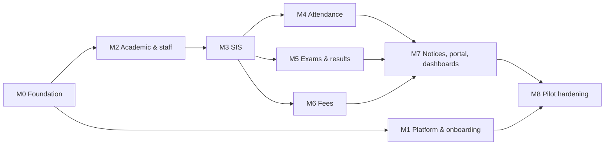

# School ERP: Backend implementation plan (Phase 1a)

> **Status:** Draft v0.2 · **Owner:** Biprodas Roy · **Last updated:** 2026-10-18
> This doc covers build order and acceptance criteria for `backend/` (NestJS 11, TypeORM 1.x, PostgreSQL) in Phase 1a.
> It does not specify the product. The specs are in [`prd.md`](./prd.md) (v1.3) and [`domains-and-routing.md`](./domains-and-routing.md); code conventions are in [`../CLAUDE.md`](../CLAUDE.md).

---

## 0. How to use this plan

- **Milestones are in dependency order** (section 3). M0–M8 together are Phase 1a of PRD section 12.
- Each milestone has the same parts: **Scope · Tasks (tables, endpoints, rules) · Done when**.
- **Tick the checkboxes as work lands**, so the doc also works as a tracker. Tick a parent item only when all its children are ticked.
- A milestone is **done** only when every "Done when" box is ticked and each module meets the [Definition of done](#13-definition-of-done-every-module).
- This is a starting plan, not a fixed spec. When implementation shows a better way, change the code and update this doc to match.
- Items marked **(1b)** are listed only so Phase 1a leaves room for them; they are tracked in section 14.

**Current state:** M0 in progress (4.1–4.7 done; DB-backed checks wait for the local database or the first CI run). Section 1 lists what already exists and can be reused.

---

## 1. Where the backend stands today

**Solid and reusable**

- Tenancy: `OrgScopedEntity`, `BaseTenantRepository` (`findPage`, `deleteById` with soft delete, `findByIdOrFail`), `scopeRepository` pinning, `ds.runInTransaction`, RLS (`rls.ts`) and the restricted app role, `TenantMiddleware` with header → subdomain → custom-domain resolution, `TenantConnectionService.getScopedConnection(orgId)`.
- Custom domains, DNS checks, the TLS ask endpoint, and cross-host handoff codes (all done, with e2e tests).
- Response envelope, global exception filter (unique/FK violations → 409), pagination DTOs, pino logging with `reqId`/`orgId`/`userId`, `TenantThrottlerGuard`, Swagger, the Joi env schema.
- Mail: `shared/mail` (`@nestjs-modules/mailer` + Handlebars), templates for activation, verification, reset and welcome.
- Auth: platform and tenant JWT realms, email verification, password reset, owner activation, `OwnerProvisioningService`, RBAC with code-defined permissions and per-org roles, the `isAdmin` bypass.
- Academic and people CRUD: academic years (one current), permanent classes, subjects, subject groups, per-year class curriculum (`class_subjects`, `class_subject_groups`), class/subject teachers per year, enrollments with student subjects, students with addresses, emergency contacts, documents, notes and a medical record, guardians with links, employees with departments and designations.
- Tests: 43 unit specs, 8 e2e specs that run against a real Postgres with RLS on.

**Missing or wrong for Phase 1a**

| Area | Gap |
| ---- | --- |
| Identity | `users.email` is required, there is no `phone`; no lockout after failed logins; one long-lived JWT (1 day), no refresh tokens or session list; no general invite flow (tenant `POST /users` sets a password directly) |
| Platform | `POST /organizations` is open to any platform user; `organizations` has no plan, trial, type, profile or onboarding columns; no plans/entitlements; no self-serve "sign up a school" flow; slug regex allows `_` and there is no reserved list; no slug history |
| RBAC | ~~No scope rules; system roles don't match PRD 6.3~~ (done in 4.4) |
| Academic | No shifts, terms, rooms; sections are a global name list joined to classes by `class_sections` (no session, no shift); teacher assignments are not effective-dated; no rollover |
| SIS | No generated student ID; status enum lacks suspended/left/dropped_out; no Bangla name fields; promotion is a single audit row with no enrollment change, no preview, no rollback; no file upload; no Excel import; guardian relation enum has `BROTHER = 'BROTHER'` |
| Missing modules | Settings, audit log, numbering, file storage, queues, PDFs, attendance, holidays, exams/grading, fees, notices/notifications, portal, dashboards/reports |
| Cleanup | `stakeholders` module (not in the PRD); `console.log` hooks in `User`; `class-subject-groups` and `subject-teachers` have no PATCH |

---

## 2. Conventions used by every module

These follow `CLAUDE.md`; the rows marked **new** are introduced by this plan.

| Topic | Convention |
| ----- | ---------- |
| **Tenanted tables** | Extend `OrgScopedEntity`. Per-org unique keys include `orgId`; soft-deletable keys are partial (`WHERE deleted_at IS NULL`). Each migration that creates one enables RLS, creates `org_isolation` and grants the app role, copying `1792321369675-OrganizationDomains.ts`. |
| **Platform tables** | Plans, signup requests, slug history, geo data and platform audit are plain entities read through the root connection with `@InjectRepository`. Their routes go in the `TenantMiddleware` exclude list. |
| **Permissions** | Every new endpoint gets catalog keys and `@RequirePermissions`. Setup resources keep `resource:read\|create\|update\|delete`. Workflow actions get task keys named in the PRD: `attendance:take`, `attendance:edit_locked`, `results:enter`, `results:verify`, `results:approve`, `results:publish`, `results:reopen`, `fees:collect`, `fees:cancel_receipt`, `fees:approve_waiver`, … System-role seed updates ship in the same change. |
| **Scope** (new) | Endpoints that read or write section or subject data call `AccessScope` (M0) and filter by it. Query builders add the `orgId` filter by hand (they aren't rewritten). |
| **Audit** (new) | Auth events, permission/role changes, financial records, mark changes, attendance corrections and data exports call `AuditService.record(...)` inside the same transaction as the change. |
| **Money** (new) | `bigint` minor units (poisha) in the DB and the API, with a `currency` from org settings. No floats anywhere in fee math. |
| **Dates** (new) | Business dates (attendance day, due date, billing period) are `date` columns computed in the org's time zone (`Asia/Dhaka` default); instants are `timestamptz`. |
| **Bulk work** (new) | Imports, invoice runs, PDF batches, exports and notification fan-out run on a BullMQ queue, tracked by a `jobs` row that the client polls. Request handlers only enqueue. |
| **Idempotency** (new) | Retryable writes (attendance submit, payment record, imports, bulk actions) accept an `Idempotency-Key` header, stored per org with the response for 24 hours. |
| **Error codes** (new) | `GlobalExceptionFilter` adds a stable `code` (e.g. `ATTENDANCE_LOCKED`, `SLUG_TAKEN`) next to `message`, so the frontend can localize errors into Bangla. |
| **Module boundaries** | Modules call each other's exported services, never repositories. Composite views (student 360, dashboards, portal) live in their own modules that depend on feature services. |
| **Tests** | Pure logic (grading, fees, numbering, scope) gets unit suites. Each milestone adds e2e specs for its PRD acceptance criteria plus cross-tenant and IDOR cases (PRD 11.4). |

---

## 3. Milestone overview

| # | Milestone | Estimate (PRD 12.2) | Depends on | Status |
| - | --------- | ------------------- | ---------- | ------ |
| M0 | Foundation hardening | 1–2 weeks | — | ☐ |
| M1 | Platform admin, onboarding and Google sign-in | ~1.5–2 weeks (overlaps M0) | M0 | ☐ |
| M2 | Academic structure and staff directory | 1.5–2 weeks | M0 | ☐ |
| M3 | Student information system | 1.5–2 weeks | M2 | ☐ |
| M4 | Attendance and student leave | 2 weeks | M2, M3 | ☐ |
| M5 | Exams and results | 3 weeks | M2, M3 | ☐ |
| M6 | Fees | 3 weeks | M3 | ☐ |
| M7 | Notices, notifications, portal, dashboards | 2–3 weeks | M4, M5, M6 | ☐ |
| M8 | Settings completion and pilot hardening | 2 weeks | all | ☐ |

M4, M5 and M6 don't depend on one another, so they can be reordered (fees first if a pilot school needs billing early). The total is roughly 17–20 weeks for one developer.

---

## 4. M0: Foundation hardening

**Scope:** clean up, add the infrastructure modules every later milestone needs, and bring identity, RBAC, audit and settings up to the PRD.

### 4.1 Cleanup

- [x] Drop `stakeholders` (migration `1792330000000-DropStakeholders`):
  - [x] Remove the module, its catalog keys, the `stakeholder` system role in the seed, and the import in `app.module.ts`.
  - [x] Migration `DropStakeholders`: delete `user_roles` rows for that role, delete the role rows, drop the table, revoke the grant.
  - [x] Update `CLAUDE.md`, `backend/README.md`, `doc/db-schema.md`, `doc/example-menu-frontend.md`.
- [x] Fix `GuardianRelation.BROTHER` to `'brother'`, with a data migration (`1792330000001-GuardianRelationLowercase`).
- [x] Remove the `console.log` entity hooks in `User`.
- [x] Restrict `POST /organizations` to `PlatformAdminGuard` (self-serve creation moves to the signup flow, M1).
- [x] Leave `timetable` dormant: no new work, out of seeded roles and the frontend menu (its `section_id` FK moves in M2). *Only `admin` holds `timetables:*`/`periods:*`; the staff sidebar entry is gone (the student portal's own timetable link stays until M7).*

### 4.2 Infrastructure modules

- [x] **Dependencies:** `bullmq` + `ioredis`, `@aws-sdk/client-s3`, `@aws-sdk/s3-request-presigner`, `puppeteer` (24.x, the last CommonJS line), `exceljs`, `@fontsource/noto-sans-bengali` / `noto-serif-bengali`, `nestjs-cls` (for 4.5). *Not used: `@nestjs/bullmq` 12 and `file-type` 22 are ESM-only; the queue uses plain BullMQ behind `JobQueue`, and uploads use a built-in signature check (`modules/files/file-type.ts`).*
- [x] **Local stack:** MinIO in `docker-compose.yml` (API :9000, console :9001) plus a `minio-init` job that creates the private `school-erp` bucket; `.env.docker.example` updated.
- [x] **Env vars** in `env.validation.ts`, `backend/.env.example` and `.env.development`: `QUEUE_DRIVER`, `REDIS_URL`, `QUEUE_CONCURRENCY`, `S3_ENDPOINT`, `S3_REGION`, `S3_BUCKET`, `S3_ACCESS_KEY`, `S3_SECRET_KEY`, `S3_FORCE_PATH_STYLE`, `S3_SIGNED_URL_TTL`, `UPLOAD_MAX_BYTES`, `PDF_CONCURRENCY`, `PDF_CHROME_PATH`, `PDF_NO_SANDBOX`, `FIELD_ENCRYPTION_KEY`, `FIELD_ENCRYPTION_OLD_KEYS` (S3 credentials and the encryption key are required in production). *`JWT_REFRESH_TTL` comes with 4.3.*
- [x] **`QueueModule`** (`src/shared/queue/`):
  - [x] Queues `mail`, `notifications`, `pdf`, `imports`, `billing`, `exports`. Inject `JobQueue` to enqueue; mark handlers with `@JobHandler(queue, name)` on singleton providers (found at startup by `JobHandlerRegistry`). BullMQ driver: one worker per queue with handlers, 3 attempts with exponential backoff by default.
  - [x] Job payloads always carry `orgId` and `actorUserId` (`JobPayload`).
  - [x] `inline` driver under `NODE_ENV=test` (or `QUEUE_DRIVER=inline`): runs real handlers in-process with retries; tests `await queue.drain()`.
- [x] **Tenant context for workers** (`src/tenancy/tenant-job.runner.ts`, `TenantJobRunner`):
  - [x] `run(orgId, work, actor?)` registers a synthetic request for a fresh DI context, so `TENANT_DATASOURCE` and every tenant repository resolve exactly as in a request.
  - [x] Releases the QueryRunner when `work` settles (also on error).
  - [ ] Spec: a job for org A can't see org B's rows. *Unit spec covers separate connections per org; the RLS check needs the e2e database.*
- [x] **`jobs` module** (`src/modules/jobs/`): org-scoped `jobs (type, status queued|running|succeeded|failed, progress, result jsonb, error, attempts, created_by, file_id, started_at, finished_at)`; `JobService.start()` creates the row and enqueues; `JobTracker.run()` wraps a handler and keeps the row current; `GET /jobs/:id` (creator or school admin, else 404).
- [x] **`StorageModule`** (`src/shared/storage/`): `put`, `getSignedUrl(key, ttl = S3_SIGNED_URL_TTL)`, `getBuffer`, `delete`; keys are `orgs/<orgId>/<kind>/<uuid>`.
- [x] **`files` module** (`src/modules/files/`):
  - [x] Org-scoped `files (key, original_name, mime, size, sha256, purpose, uploaded_by)`; the id is generated by the app because it is part of the key.
  - [x] Per-purpose allow-list (`file-purposes.ts`) of sniffed types and sizes; `FileUpload(purpose)` interceptor (multer memory storage) for feature endpoints. *No generic `POST /files`: each feature endpoint uploads through `FileService` behind its own permission.*
  - [x] Signed download URLs via `FileService.getDownloadUrl`, called by owning modules after their permission check.
  - [ ] Plan storage quota. *Needs `EntitlementService` (M1); marked `TODO(M1)` in `FileService`.*
  - [ ] Virus scanning **(1b)**.
- [x] **`PdfModule`** (`src/shared/pdf/`):
  - [x] One shared headless Chrome, at most `PDF_CONCURRENCY` pages at once; Handlebars templates in `src/shared/pdf/templates/` (copied by `nest-cli.json`).
  - [x] Bundled Noto Sans/Serif Bengali inlined as data URIs; the smoke test checks both fonts are embedded in a Bangla PDF.
  - [x] `render(template, data, { paper: 'A4' | 'A4-landscape' | 'Legal' | 'Legal-landscape' | '80mm' })` and `renderHtml(...)` return a Buffer; 80 mm height follows the content.
  - [ ] Production image includes Chromium. *No production Dockerfile yet; note for deployment: Ubuntu 24+ hosts block Chrome's sandbox for downloaded builds, so run as a non-root user with a system Chromium (`PDF_CHROME_PATH`) or set `PDF_NO_SANDBOX=true` only inside a locked-down container.*
- [x] **Spreadsheet helpers** (`src/shared/spreadsheet/spreadsheet.ts`): `buildTemplate` (headers, example row, dropdowns), `parseSheet` (XLSX/CSV, loose header matching, typed values, all row errors collected), `writeSheet`.
- [x] **`NumberingService`** (`src/modules/numbering/`):
  - [x] Org-scoped `numbering_sequences (org_id, key, scope, next_value)`.
  - [x] `next(key, scope)` is one atomic upsert that row-locks the counter inside the caller's transaction, so a rollback never burns a number.
  - [x] `formatNumber(pattern, seq, ctx)` supports `{YYYY}`, `{YY}`, `{MM}`, `{CLASS}`, `{SEQ}` / `{SEQ:n}`; `assertValidPattern` requires one `{SEQ}`.
  - [x] Unit suite.
  - [ ] Concurrency e2e (parallel `next()` calls give distinct, gap-free numbers). *Needs the e2e database.*
- [x] **Field encryption** (`src/shared/crypto/field-encryption.ts`): `EncryptedColumn` transformer, AES-256-GCM, `v1:<keyId>:<iv>:<tag>:<data>`, old keys stay readable via `FIELD_ENCRYPTION_OLD_KEYS`, `needsReencryption()` for rotation.
- [x] **`@Idempotent()`** (`src/modules/idempotency/`): org-scoped `idempotency_keys`, atomic claim (`INSERT … ON CONFLICT`, expired keys reclaimed), replay with the stored status, 422 for a reused key with a different body, 409 while in progress, key freed on failure; hourly cleanup of expired keys.
- [x] **Error `code`** in `GlobalExceptionFilter`: explicit `code` from the exception body, else derived from the status (`NOT_FOUND`, …), `VALIDATION_FAILED`, `UNIQUE_VIOLATION`/`FOREIGN_KEY_VIOLATION`, `INTERNAL_ERROR`.
- [x] Migration `1792330000002-InfrastructureTables` (`jobs`, `files`, `numbering_sequences`, `idempotency_keys`) with RLS and app-role grants. *Written from TypeORM's metadata (`scripts/print-ddl.ts`) since no database was available; confirm with `db:migrate` + `db:generate` (no drift).*

### 4.3 Identity (PRD 5.1, 6.3)

- [x] **Email or phone:**
  - [x] Migration `1792330000003-IdentityAndSessions`: `users.email` nullable (existing emails lower-cased), `phone` varchar(16) unique, `chk_users_email_or_phone`, `phone_verified_at`, `must_change_password`. *Unique constraints stay plain (Postgres allows many NULLs); emails are normalized in the app instead of a `lower()` index.*
  - [x] Normalization in `common/identity/identifier.ts`: emails trimmed + lower-cased; Bangladesh mobiles (`01…`, `8801…`, `+880 1…`) → E.164; other countries need `+<cc>…`. `@IsPhone()` validator.
  - [x] Login DTOs take `identifier` (email or phone) + password in both realms; `email` is still accepted as a deprecated alias so the current frontend keeps working.
  - [x] JWT payload drops `email`; `AuthUser` and both strategies follow (`sessionId`, `mustChangePassword` added).
- [x] **Lockout** (`CredentialService`, shared by both realms): `failed_login_count`, `locked_until`; the 5th wrong password locks for 15 minutes (atomic SQL step), success resets; unknown accounts get the same answer after a dummy bcrypt compare.
  - [x] Lockouts written to the audit log and listable by school admins (`GET /audit-logs?action=auth.account_locked`).
- [x] **Sessions and refresh tokens** (`SessionService`):
  - [x] `user_sessions (user_id, org_id nullable, refresh_hash, family_id, user_agent, ip, created_at, last_used_at, expires_at, revoked_at)`; root connection only (identity data), no RLS.
  - [x] Access JWT carries `sid` (the family id). *Access lifetime stays `JWT_EXPIRES_IN` (long) until the frontend refreshes tokens, then set it to `15m` (decision 2026-10-18).* Refresh tokens (`JWT_REFRESH_TTL`, default 30d) rotate on every use; reusing one, or losing a concurrent refresh, revokes the family (`REFRESH_TOKEN_REUSED`).
  - [x] Both realms: `POST …/refresh`, `POST …/logout`, `GET …/sessions`, `DELETE …/sessions/:id`, `POST …/logout-all` (every school and the platform).
  - [x] Strategies refuse tokens without `sid` or with a revoked one (`SESSION_REVOKED`); positive answers are cached 60 s per process, and revocations clear the local cache at once.
  - [x] Idle timeout from org settings (`security.sessionIdleMinutes`): `SessionService.rotate` refuses and revokes a school sign-in not refreshed within it (`SESSION_IDLE_TIMEOUT`). *Checked at refresh, so it bites once access tokens are short-lived (15m).*
  - [x] A session is only refreshable on its own school (or the platform), so a token from one school can't be refreshed on another.
  - [x] Password reset ends every session; password change ends the others and returns a fresh access token for the current one.
- [x] **Invites** (`POST /users/invite`, `InviteService` in AuthModule because it mints activation tokens):
  - [x] `OrgUserService.addMember` finds the account by email or phone (or creates it), refuses an email + phone of two different accounts, adds the membership and roles.
  - [x] Email → activation link (membership PENDING until used); phone only → a 10-character temporary password returned once for a slip (`must_change_password`); existing account → linked, keeps its password.
  - [x] `POST /users` keeps working: the admin-chosen password is temporary (`must_change_password`), and email or phone is accepted.
  - [x] `OwnerProvisioningService` keeps its activation path; it now skips the email for owners without one.
  - [x] While `must_change_password` is set, both JWT guards answer 403 `PASSWORD_CHANGE_REQUIRED` except on routes marked `@AllowPendingPasswordChange()` (me, change-password, logout, logout-all).
- [ ] **Bulk credential slips** (`POST /users/credential-slips`). *Moved to M3: it needs per-session sections and guardian/student portal accounts.*
- [ ] Frontend follow-up: "Continue with Google" on every login page (M1 5.5); NextAuth stores the refresh token, refreshes before expiry, sends `identifier`, handles `PASSWORD_CHANGE_REQUIRED`; then set `JWT_EXPIRES_IN=15m`.
- [x] Tests: identifier, lockout, session rotation/reuse/binding, strategies, forced-change guard, invites, `addMember` (unit); `test/auth-sessions.e2e-spec.ts` (DB) for the PRD 6.3 acceptance flows. *The DB e2e specs haven't run yet (no local database).*
- [x] Fixed on the way: `UserService.findAll` (platform users) passed unset filters as `undefined`, which TypeORM 1.x rejects on unscoped repositories.

### 4.4 RBAC alignment and scope rules (PRD 4.4, 6.3)

- [x] **System roles** per PRD 6.3: `admin`, `principal`, `accountant`, `teacher`, `class_teacher`, `receptionist`, `librarian`, `committee_member`, `student`, `guardian`, with permission sets from the 4.4 matrix (updated as milestones add keys). `committee_member` gets read-only keys only (dashboards, reports, settings, academic setup, finance summaries), never the sensitive student keys (`student_medical:*`, `student_notes:read_sensitive`, guardian details).
  - *Today's keys only: `committee_member` = `domains:read` + academic setup read; dashboards, reports, settings and finance keys join as their milestones add them. Users & roles stay admin-only (no other role has `users:*`/`roles:*`). Roles with student read access but no academic-setup column (accountant, receptionist, librarian) get `academic_years`/`classes`/`sections:read` as lookups. `system-roles.seed.spec.ts` checks the matrix rules.*
- [x] Migration `1792330000004-AlignSystemRoles` for existing orgs: rename `parent` → `guardian`, move `staff` holders to `principal`, insert the missing roles, rewrite permissions (and scope) of `is_system` roles; custom roles untouched (one using a new system name is renamed `<name> (custom)`). *Holds a frozen copy of the role sets; `down` restores the previous ones. Not yet run against a database.*
- [x] `POST /roles/:id/clone { name, description? }` (`roles:manage`): copies permissions and scope into a custom role. `scope` is also settable on create/PATCH.
- [x] **Scope:**
  - [x] `roles.scope` (`school` | `assigned`, default `school`); seeded `teacher` and `class_teacher` use `assigned`.
  - [x] `PermissionResolverService.getPermissionScopes` returns, per permission key, the widest scope among the user's roles that grant it (roles read once per request).
  - [x] Request-scoped `AccessScope` (`src/modules/access-scope/`, its own module because `TeachingModule` depends on `RbacModule`): `can(key)`, `sections(key)` (`null` = unrestricted, else class-sections with a class- or subject-teacher assignment in the current session), `subjectAssignments(key)`, plus `canAccessSection`/`canAccessSubject`. Data from the exported `TeachingService.activeAssignmentsForUser`, cached per request. *Sections are still a global name list shared by classes, so a section is a `{ classId, sectionId }` pair and a subject assignment `{ classId, sectionId, subjectId }`; M2 (per-session sections, `class_subject_id`, effective dates) reduces these to `sectionId` / `(sectionId, classSubjectId)`.*
  - [x] Unit suite for permission evaluation with scopes (PRD 11.1): `access-scope.service.spec.ts`, `permission-resolver.service.spec.ts`, `teaching.service.spec.ts`.
  - [ ] Existing student/enrollment/teaching list endpoints filter by `AccessScope`. *They predate it; each is retrofitted when its module is reworked (M2 for teaching and sections, M3 for SIS, covered by the M2 "scoped teacher sees only their own sections" e2e).*
- [x] Guardian and student roles hold only `portal:*` keys (`portal:access`), so their tokens are refused on staff endpoints (portal endpoints in M7).

### 4.5 Audit log (PRD 6.3, 8.1)

- [x] Org-scoped `audit_logs (actor_user_id, actor_type user|platform|system, action, entity_type, entity_id, before jsonb, after jsonb, ip, user_agent, request_id, impersonator_id, created_at)` (`src/modules/audit/`, migration `1792330000005-AuditLogs`). *Actor and entity ids are plain columns (no FK), so rows outlive the user or record; they go with their school. Actions are text, listed in `audit-actions.ts`.*
- [x] `platform_audit_logs` with the same shape plus a nullable `org_id` (no FK, so a school's deletion stays logged), no RLS, root connection only.
- [x] Immutable: the migration grants the app role only `SELECT, INSERT` on `audit_logs` (and nothing on `platform_audit_logs`); dev bootstrap does the same (`APP_ROLE_APPEND_ONLY_TABLES` in `rls.ts`).
- [x] `AuditService.record()` takes actor, IP, user agent and request id from the request context: `RequestContext` (`src/shared/request-context/`) over `nestjs-cls` (open point 15), whose middleware keeps the request; `TenantJobRunner` opens a CLS context per job with its synthetic request. It writes through the tenant connection, so it joins the caller's `ds.runInTransaction`. `PlatformAuditService.record(entry, manager?)` does the same on the root connection. Secret-looking keys are dropped from `before`/`after`.
- [x] Auth events (login, failed login, lock, activation, password change and reset, logout, logout-all, session revoke) in both realms, and role/permission changes (role create/clone/update/delete with before and after, role assign/unassign, member add/update/remove, admin grant/revoke). Platform: organization create/update/delete and ownership transfer, membership create/update/remove.
  - *A failed sign-in names the actor only if they're a member of that school; anyone else is logged anonymously (`unknown_account`), so a school's log never reveals accounts elsewhere. Credential and session changes live on the root connection, so their audit rows follow the change rather than sharing its transaction.*
  - *Not audited yet: token refresh (too frequent) and refresh-token reuse; attempts on an already-locked account.*
- [x] `GET /audit-logs` with filters (`action`, or a prefix like `role.`; `entityType`, `entityId`, `actorUserId`, `from`, `to`; paginated) behind `audit:read` (admin role; existing orgs' admin roles get it in the migration). Also `GET /platform/audit-logs` (`orgId` filter) for super-admins.
- [x] Tests: `audit-entry`, `audit.service`, `platform-audit.service`, `request-context`, `auth-audit` (sign-in events), role and member audit cases (unit); `test/audit-log.e2e-spec.ts` (DB: rows written, isolation, app role can't UPDATE/DELETE). *The e2e spec hasn't run yet (no local database).*

### 4.6 Settings (PRD 6.24)

- [x] Extend `organizations`: `type` (school/college/madrasa/coaching/english_medium), `plan_id`, `trial_ends_at`, `onboarding_completed_at`, `listed_in_directory`, `eiin`, `logo_file_id`, `parent_org_id` (nullable, unused until Phase 3). Add `trial` and `past_due` to `OrganizationStatus` (migration `1792330000006-OrgSettings`).
  - *`plan_id` has no FK until `plans` exists (M1). `trial` and `past_due` schools resolve and work like active ones (`isOperationalOrganization`, used by `TenantMiddleware`, the public resolve endpoints and platform handoff).*
- [x] Org-scoped `org_settings` (one row per org, `uq_org_settings_org`) with a jsonb column per section, each validated by a DTO (`src/modules/settings/`). Types in `settings.types.ts`, defaults in `settings.defaults.ts`; stored values merge over the defaults, so a new field needs no data migration. The row is created with the organization (`OrgSettingsSeeder`, back-filled by `1792330000008-OrgSettingsRows`); writes lock it and store only the fields a school changed.
  - [x] `profile`: Bangla name, address, contact, website, founding year, principal name and signature file, brand colors, letterhead options. *The logo is `organizations.logo_file_id`.*
  - [x] `locale`: language, date format, numerals (bn/en), currency (ISO 4217), time zone (IANA), week start, weekend days. *Defaults: English, `DD/MM/YYYY`, BDT, `Asia/Dhaka`, week from Saturday, Friday off.*
  - [x] `numbering`: patterns for student ID, roll, receipt, invoice, certificate (each needs exactly one `{SEQ}`), plus `allowManualStudentId` (M3).
  - [x] `portal`: `studentAccounts`, `studentMinLevel` (default 6), or an explicit `studentClassIds` list.
  - [x] `results`: `verifyStep` on/off (default off).
  - [x] `attendance`: mode (day/period), lock after N days (default 7), cutoff time.
  - [x] `fees`: billing day (1–28), grace days, block results on dues.
  - [x] `notifications`: in-app/email/SMS per event (absent, fee due, payment received, result published, notice published), SMS sender ID (1b).
  - [x] `security` (added): `sessionIdleMinutes` for the idle timeout from 4.3.
- [x] `GET /settings` (`settings:read`) and `PATCH /settings/<section>` (`settings:update`), one typed route per section so the global ValidationPipe checks each body; nested objects merge, arrays replace, `null` clears a nullable field. Every change is audited (`settings.updated`, entity id = section) with before and after.
  - [x] `PATCH /settings/organization` for the school's own fields (name, type, EIIN, directory listing); `POST /settings/files/logo` and `/settings/files/signature` upload through `FileService` (the old file is removed). `GET` includes signed URLs for both.
  - [x] `GET /settings/display` (any signed-in member): name, logo URL, colors, locale, for branding and formatting pages.
  - [x] Seeds and migration: `admin` gets `settings:read`/`settings:update`; `principal` and `committee_member` get `settings:read`.
- [x] `SettingsService.get()` memoized per request and cached in memory per school (60 s TTL, `settingsCache`), invalidated on write; `OrgSettingsReader.get(orgId)` for singletons, through a tenant-pool connection scoped to the school. *Other processes see a change within the TTL.*
- [x] Tests: defaults and merge, DTO validation, `SettingsService`, `OrgSettingsReader`, session idle timeout (unit); `test/settings.e2e-spec.ts` (DB: defaults, merge, isolation, validation, organization fields, audit). *The e2e spec hasn't run yet (no local database).*

### 4.6a Review fixes (2026-10-20)

A review of 4.1–4.7 found these security gaps; all are fixed with unit tests (DB e2e still pending):

- [x] **No role escalation:** outside school admins, `RoleService` refuses to create, edit, clone, assign or unassign a role with keys the caller doesn't hold (or school-wide when they only hold it `assigned`). This covers `POST /employees` `createUser.roleIds` and `POST /users`/invite `roleIds` (`findAssignable`). Only school admins change or remove a school admin. System roles: scope locked, `admin` permissions locked, guardian/student portal-only, no role mixes portal and staff keys.
- [x] **Pre-registered accounts:** an invite or `POST /users` for a PENDING (registered, never verified) account resets its password instead of linking it; tenant sign-in refuses PENDING accounts (`ACCOUNT_PENDING`).
- [x] **Activation:** never replaces a password the owner chose (`CredentialService.hasOwnPassword`: active, not temporary, and verified or active in some school); for such accounts it checks that password (with lockout) instead. Only PENDING memberships are activated; the token is consumed atomically; setting a password ends the account's other sessions. `GET /auth/activate` returns `hasPassword`. Platform-admin-created users get `must_change_password`.
- [x] **Sessions end when access shrinks:** removing, suspending or revoking school admin (tenant and platform), demoting/removing an old owner on transfer, and suspending or un-admining a platform user revoke the affected sessions (`SessionService.revokeAllForUserInOrg` / `revokeAllForUser`). `SessionService` moved to `SessionModule`.
- [x] **Client IP:** `req.ip` with Express `trust proxy` (`TRUST_PROXY`) in sessions, audit, request context and the throttler; the raw `X-Forwarded-For` header (forgeable, and longer than the 64-character column) is no longer read.
- [x] **Lockout race:** each attempt claims a slot in `failed_login_count` before the password check, and a right password that finishes after a lock started is refused.
- [x] **Idempotency keys per user** (`<userId>:<key>`, migration `1792330000007-IdempotencyKeyPerUser`).
- [x] **Settings:** nested-object fields reject arrays (`@IsObject`, merge keeps objects); writes lock the row; the row is created with the org (migration `1792330000008-OrgSettingsRows` back-fills); only changed fields are stored; the 60 s cache can't be refilled with stale values (per-org generation) and cached values are frozen; replaced logo/signature files are removed after commit (new uploads removed on failure); an organization field change commits only after its audit row; public resolve endpoints no longer return `status`; `OmitOrValidate` removed.
- [x] **Audit:** `clock_timestamp()` plus a `seq` identity tie-breaker; secret filter by exact keys and suffixes (`passMark` survives); platform email verification records `auth.account_activated`; platform actor type is `platform`/`user`/`system`; strict ISO dates in filters; no-op role updates aren't recorded; migration 0005 resolves the app role like `AppRoleGrants`; the isolation e2e now has rows in both schools; the `RequestContext` param decorator is renamed `ReqContext`; sensitive reads are audited (medical record, health notes).
- [x] **Identity and infra:** BD phone normalization handles `+880 01…`; idempotency replay status verified with an HTTP test; session cache prunes expired entries; job errors shown to users are safe and a failed enqueue marks the job failed; `hashPassword` moved to `common/identity/password.ts`; dead code removed; `FIELD_ENCRYPTION_KEY` required in staging too.
- [x] **RBAC and teaching:** `PATCH /subject-teachers/:id` and `PATCH /class-subject-groups/:id`; the medical upsert accepts `student_medical:create` or `:update`; unused `promotions:update` and `student_subjects:update` removed; migration 0004's `(custom)` rename can't collide and its `down()` is minimal (no broad grants); `TeachingService` returns fresh empty results; unused `AccessScope.can()` removed.
- [x] **Tests and CI:** e2e specs for numbering concurrency, `TenantJobRunner` isolation and the queue/jobs flow (not run yet: no database); `test:release:e2e` runs in band; CI drops the unused Redis service and runs frontend lint (its four React Compiler errors fixed). The Bangla PDF check stays in `pdf.service.spec.ts` (real Chrome in the unit job).
- [ ] **Still open:** storage smoke e2e (CI needs a MinIO container); paging reuse in `PlatformAuditService.findFiltered`; whether disciplinary notes count as sensitive (today only health notes); public home page settings and other signatures (PRD 6.24); TOTP (PRD 6.3, not scheduled); branch protection (repository setting).

### 4.7 CI

- [x] GitHub Actions (`.github/workflows/ci.yml`, on every PR and push to `main`): backend `format:check`, `lint:check` (no `--fix`, no warnings), `typecheck`, `npm test`, `npm run build`; `npm run test:e2e --runInBand` with Postgres 17 and Redis 7 service containers (the run creates `school_erp_e2e` and the restricted app role itself); frontend `next build`.
  - [ ] Required on every PR: mark the three jobs as required status checks in `main`'s branch protection (a repository setting, not code).
  - [ ] Frontend lint in CI, after fixing its four React Compiler `set-state-in-effect` errors (theme toggles, carousel, `use-mobile`).
- [x] Tenant-isolation, grading and fee suites named so the PRD 11.5 release criteria can point at them: tests carry `[tenant-isolation]`, `[gpa-regression]` or `[fee-regression]` in their names, and `npm run test:release` runs exactly those (unit and e2e). Tagged so far: the tenant-isolation e2e and repository-scoping suites plus single cross-school cases; the grading and fee tags arrive with M5 and M6. Listed in `backend/README.md` ("Release suites").

### Done when

- [ ] Stakeholders are gone and the app boots with no reference to them.
- [ ] Email-or-phone login, lockout, refresh/session revoke and invites work end to end (e2e).
- [x] Scope rules are covered by the unit suite.
- [ ] Audit rows are written for auth and role changes, and the app role can't update or delete them. *Implemented; checked by `test/audit-log.e2e-spec.ts` once it runs against a database.*
- [ ] Queue, storage, PDF (with Bangla text) and numbering have passing smoke e2e tests.
- [ ] CI is green on a PR. *Workflow in place; not yet run on GitHub.*

---

## 5. M1: Platform admin and onboarding

**Scope:** PRD 6.1 Phase 1a (super-admin only), 6.2, Google sign-in from 6.3, 7.1 and `domains-and-routing.md` sections 2–5a.

### 5.1 Plans and entitlements (PRD 3.3, 6.1)

- [ ] Platform table `plans (code, name, price_per_student, min_fee, modules text[], limits jsonb {students, storage_mb, users, admins})`, seeded with Free/Basic/Standard/Premium.
- [ ] `EntitlementService` (exported, cached per org): `hasModule(org, key)`, `assertLimit(org, 'students', delta)`; the trial grants Standard.
- [ ] `@RequireModule('fees')` decorator + guard → 403 `MODULE_NOT_IN_PLAN`.
- [ ] Platform endpoints (`PlatformAdminGuard`), each writing `platform_audit_logs`:
  - [ ] `PATCH /organizations/:id/plan`
  - [ ] `POST /organizations/:id/trial/extend { days }`
  - [ ] `PATCH /organizations/:id/limits`
- [ ] School directory: `GET /organizations` gains filters (plan, status, type, district, created range) and columns (active student count via a cached counter, plan, trial end).

### 5.2 Slugs

- [ ] One reserved list in `backend/src/shared/slug/reserved-slugs.ts`, served at `GET /public/slugs/reserved` for `frontend/src/lib/tenant.ts`.
- [ ] Slug rule `^[a-z0-9](?:[a-z0-9-]{1,38}[a-z0-9])$` in every DTO; a migration rewrites existing slugs containing `_`.
- [ ] `GET /public/slugs/check?slug=` returns availability plus up to three suggestions; rate-limited.
- [ ] `organization_slug_history (org_id, slug unique, expires_at)`.
- [ ] `PATCH /settings/slug` (school admin, once per 30 days) in one transaction with a history row.
- [ ] `TenantMiddleware` and `/public/organizations/resolve` return a redirect target for an old slug; history slugs can't be claimed until they expire.

### 5.3 Self-serve signup (PRD 6.2, 7.1)

- [ ] Platform table `signup_requests (school_name, type, slug, owner_name, email, phone, password_hash, token_hash, expires_at, completed_at)`; it never reserves the slug.
- [ ] `POST /public/signup`: validate, store, email the verification link; uniform response.
- [ ] `POST /public/signup/verify { token }`, in one transaction:
  - [ ] Re-check the slug.
  - [ ] Create or link the user (an existing verified account keeps its password).
  - [ ] Create the org through `OrganizationService.createOrganization` with `trial_ends_at = now + 30 days`.
  - [ ] Issue a handoff code; the client redirects to `https://<slug>.<root>/auth/handoff?code=…&next=/onboarding`.
- [ ] SMS OTP step on the same request record **(1b)**.

### 5.4 Onboarding and "Find your school"

- [ ] `GET /onboarding/checklist` computes each step from real data (profile, current session, classes + sections, curriculum, grading system, fee heads, staff invited, students imported) and returns a percentage.
- [ ] `POST /onboarding/complete` and `POST /onboarding/skip` set `onboarding_completed_at`; the tenant `me` response carries the flag for the frontend gate.
- [ ] Code-defined templates in `src/shared/templates/`, applied by idempotent "apply" endpoints:
  - [ ] NCTB classes and subjects (Class 1–10, groups for 9–10)
  - [ ] Cambridge
  - [ ] Alia madrasa
  - [ ] Grading templates (BD GPA 5.0 and the others in M5)
  - [ ] BD government holidays for the year
  - [ ] Default fee heads
- [ ] `POST /public/find-school { email }`: always 202; enqueues a mail listing every school with an ACTIVE membership, each linking to `https://<host>/login?identifier=…`; rate-limited per IP and per recipient. Phone input **(1b)**.
- [ ] Sample data: `POST /onboarding/sample-data` (job) fills a demo session; `DELETE` removes everything it created (`sample_batch_id`). Lowest priority.

### 5.5 Google sign-in (PRD 6.3, `domains-and-routing.md` 5a)

- [ ] Env `GOOGLE_CLIENT_ID`, `GOOGLE_CLIENT_SECRET` (optional in dev: the routes answer 404 `GOOGLE_SIGNIN_DISABLED` when unset); callback `${APP_URL}/api/oauth/google/callback`.
- [ ] Platform tables `user_identities (user_id, provider, subject, email, linked_at, last_used_at)`, unique `(provider, subject)`, and `oauth_states (state_hash, code_verifier, nonce, return_host, org_id, next, intent, user_id, expires_at, used_at)`; `users.password_set` (false for accounts created through Google signup).
- [ ] `GET /oauth/google/start?return=&next=&intent=signin|signup|link`: return-host allow-list (root subdomains, `verified`/`active` custom domains, the admin host), same-host `next` only, single-use state (10 min), PKCE S256, nonce. Excluded from `TenantMiddleware`; rate-limited.
- [ ] `GET /oauth/google/callback`: consume state, exchange code, verify the ID token (issuer, audience, expiry, nonce, `email_verified`) against Google's published keys; store no Google tokens.
- [ ] Account match: linked identity, else verified email (link it, set `email_verified_at`); never create a membership. No match → uniform error on the school's `/login`, or continue signup with the verified email (M1 5.3).
- [ ] School sign-in: the same account/membership checks as password login, then a handoff code (existing `auth_tokens` type `handoff`) and a redirect to the return host's `/auth/handoff`. Platform sign-in: a platform handoff code redeemed by new `POST /platform/auth/handoff/exchange`.
- [ ] Link (signed-in `intent=link`) and unlink (`DELETE /auth/identities/google`, refused without a password); identities listed in `GET /auth/me`.
- [ ] Audit events (4.5): Google sign-in, link, unlink.
- [ ] Tests: ID-token verification (bad issuer, audience, nonce, unverified email, expired), state reuse and expiry, open-redirect attempts, link conflicts, unlink without password (unit, Google mocked); start → callback → handoff → session (e2e with a stubbed token endpoint).

### Done when

- [ ] A school signs up, verifies by email and lands signed in on its own host (e2e).
- [ ] The NCTB template applies and the checklist shows the right percentage.
- [ ] Reserved and taken slugs are rejected with suggestions; an unverified signup reserves nothing.
- [ ] "Find your school" gives the same response for known and unknown emails (e2e).
- [ ] Only a super-admin can create schools, change plans and extend trials, and each action is in the platform audit log.
- [ ] A member signs in to their school with Google from its subdomain and from its custom domain; a non-member gets the same error as an unknown account (e2e).

---

## 6. M2: Academic structure and staff directory

**Scope:** PRD 6.4 (without batch mode) and the staff directory (decision 4 of PRD v1.3).

### 6.1 Sessions, terms, shifts, rooms

- [ ] Academic years: validate `start < end` and no overlap; `GET /academic-years/current`. Keep the `academic_years` table name; the UI calls them sessions.
- [ ] `terms (academic_year_id, name, start_date, end_date, sort_order)` with CRUD.
- [ ] `shifts (name, start_time, end_time, sort_order)` with CRUD.
- [ ] `rooms (name, building, capacity, type)` with CRUD (used by exams and timetable later).
- [ ] Catalog keys and seed updates for the three new resources.

### 6.2 Per-session sections

- [ ] New `sections (academic_year_id, class_id, shift_id nullable, name, capacity, room_id nullable, is_active)`, unique `(org_id, academic_year_id, class_id, name)`, with RLS and grants.
- [ ] Migration `PerSessionSections`:
  - [ ] For each `class_sections` row, create a section in every year that has enrollments, teacher assignments or timetable rows for that class + section; otherwise in the current year.
  - [ ] Repoint `student_enrollments`, `class_teachers`, `subject_teachers` and `class_timetables` `section_id` to the new rows (match on class + old section + year).
  - [ ] Drop `class_sections` and the old `sections`.
- [ ] Remove the global section-name CRUD and `classes/:classId/sections` routes.
- [ ] New routes: `GET/POST /sections?academicYearId=&classId=`, `PATCH/DELETE /sections/:id`.

### 6.3 Curriculum and subject components

- [ ] `subjects`: keep `(org, code)` unique; drop `is_optional`.
- [ ] `class_subjects`: add `subject_type` (compulsory/optional/fourth/elective) and `subject_group_id` nullable; drop `is_compulsory`.
- [ ] `class_subject_components (class_subject_id, component cq|mcq|practical|written|oral, full_marks, pass_marks, sort_order)` with CRUD under the class subject.
- [ ] Enrollments gain `subject_group_id`.
- [ ] `student_subjects` gains `is_fourth_subject`; at most one per enrollment, and only for a `fourth`/`optional` class subject.
- [ ] Add the missing PATCH on `class-subject-groups`.

### 6.4 Effective-dated teacher assignments

- [ ] `class_teachers` and `subject_teachers`: add `effective_from` (default session start) and `effective_to` (nullable); current-assignment unique keys become partial (`WHERE effective_to IS NULL`).
- [ ] `subject_teachers` references `class_subject_id` instead of `class_id + subject_id`.
- [ ] Changing a teacher closes the old row and opens a new one in one transaction.
- [ ] Delete only for a row created in error (no dependent data); otherwise end-date it.
- [ ] Add the missing PATCH on `subject-teachers`.
- [ ] `TeachingService.activeAssignments(employeeId, date)` (feeds `AccessScope`) and `assignmentOn(sectionId, classSubjectId, date)` (history).

### 6.5 Session rollover

- [ ] `POST /academic-years/:targetId/rollover { fromYearId, include: { sections, curriculum, teachers }, mode? }` as a job, in one transaction.
- [ ] Copies sections, class subjects with components and groups, and current teacher assignments, with new ids.
- [ ] Refuses when the target already has rows of an included kind, unless `mode: 'merge'` (skips existing names).
- [ ] Never touches enrollments.

### 6.6 Staff directory

- [ ] `employees`: generated `employee_number` via `NumberingService` (overridable), Bangla name, NID (encrypted), photo file, employment type.
- [ ] `POST /employees/:id/invite` uses the M0 invite flow with the employee's email or phone and a default role by designation.
- [ ] Staff Excel import through the import framework (M3) with type `staff`.

### Done when

- [ ] A session with shifts, terms, per-session sections and curriculum with components can be built from the NCTB template (e2e).
- [ ] The section migration runs cleanly on a copy of the dev database with existing data.
- [ ] Teacher changes keep history, and `assignmentOn` answers who taught a subject on a past date.
- [ ] Rollover copies a session and refuses to overwrite.
- [ ] A scoped teacher sees only their own sections (e2e).

---

## 7. M3: Student information system

**Scope:** PRD 6.6 (transfers within the school) and the Excel import from 6.2.

### 7.1 Profile and status

- [ ] `students`: add `name_bn`, `birth_reg_no`, `blood_group`, `previous_school`; `photo_file_id` replaces `photo_url`.
- [ ] Platform `geo_divisions`, `geo_districts`, `geo_upazilas` seeded from BBS data; `GET /public/geo/...`; addresses gain `division_id`, `district_id`, `upazila_id`.
- [ ] **Student ID:** `admission_number` generated from the org pattern (`{YY}{CLASS}{SEQ:4}` default) at create or import; manual value only when the setting allows it.
- [ ] **Status lifecycle:**
  - [ ] Enum `active`, `suspended`, `transferred`, `left`, `graduated`, `dropped_out` (`applicant` comes with admissions); migration maps `inactive` → `left`.
  - [ ] `POST /students/:id/status { status, reason, effectiveDate }` validates transitions and writes `student_status_history`.
  - [ ] Plain PATCH can no longer change status.
- [ ] **Search:** `pg_trgm` GIN indexes on English and Bangla names; search by name, ID, phone and guardian phone; filters by class, section, status, gender, religion.
- [ ] Student list export (Excel/PDF) as a job.

### 7.2 Guardians and portal accounts

- [ ] Relation enum `father`, `mother`, `local_guardian`, `brother`, `sister`, `other`; add `occupation`, `income`, `nid` (encrypted), `name_bn`.
- [ ] Partial unique `(org_id, phone) WHERE deleted_at IS NULL` on guardians (also the import match key).
- [ ] Every guardian gets a user account (email or phone) and an ACTIVE guardian membership on create or import.
- [ ] Students get an account only when their class qualifies under `org_settings.portal` (re-checked at promotion).
- [ ] All account creation goes through `OrgUserService` and the invite flow; no hand-set passwords.

### 7.3 Enrollment, transfers, promotion

- [ ] Enrollment validation: section belongs to the class and year; capacity (override with `enrollments:override_capacity`); student active; roll unique per section.
- [ ] **Transfers:** `POST /enrollments/:id/transfer { sectionId, reason, effectiveDate }` writes `enrollment_changes` and updates the enrollment.
- [ ] **Promotion** (replaces `student_promotions`):
  - [ ] `promotion_batches (from_year_id, to_year_id, class_id, status draft|committed|rolled_back, options jsonb {rollBy merit|keep|alphabetical, shuffleSections}, committed_at, committed_by)`.
  - [ ] `promotion_batch_items (enrollment_id, outcome promote|detain|conditional|graduate, to_class_id, to_section_id, new_roll, overridden, note)`.
  - [ ] `POST /promotions/batches` builds the draft (outcome from the published combined result when it exists, else promote) and computes rolls and sections; `GET` is the preview.
  - [ ] `PATCH /promotions/batches/:id/items/:itemId` for manual overrides.
  - [ ] `POST /promotions/batches/:id/commit` (job, one transaction): create next-year enrollments, mark old ones `promoted`/`completed`, graduate the final class.
  - [ ] `POST /promotions/batches/:id/rollback` within 24 hours, only if nothing references the new enrollments.
  - [ ] Migration drops `student_promotions` (moving any rows into a closed legacy batch).

### 7.4 Excel import (PRD 6.2)

- [ ] `src/modules/imports/`: `imports (type students|guardians|staff|marks, file_id, status uploaded|validating|validated|committing|done|failed, mode all_or_nothing|valid_only, totals jsonb, errors jsonb [{row, column, code, message}])`.
- [ ] `GET /imports/templates/:type`: a generated workbook with headers, examples and data-validation lists.
- [ ] `POST /imports` (upload) → validation job: required fields, formats, phone normalization, duplicates in the file and against the DB, class/section existence.
- [ ] `GET /imports/:id`: row-level preview.
- [ ] `POST /imports/:id/commit` (job): students, guardians (matched by phone), links, enrollments and portal accounts; one transaction for `all_or_nothing`, per-row savepoints for `valid_only`.
- [ ] 500 students validate and commit in well under a minute.

### 7.5 Documents, health, notes

- [ ] Documents: `file_id` replaces `file_url`; `verification_status` (pending/verified/rejected) with `verified_by`/`verified_at`.
- [ ] Health: medical record fields encrypted; the student 360 view omits health without `student_medical:read`.
- [ ] Notes: `health`, `disciplinary` and `counselling` types need `student_notes:read_sensitive`, enforced in the repository query.

### 7.6 Certificates, ID cards, student 360

- [ ] `certificates (student_id, type tc|testimonial|character|study, serial, issued_at, issued_by, data jsonb, status valid|revoked, revoke_reason, verify_token)`; serial from `NumberingService`.
- [ ] One fixed PDF layout per certificate type, with a QR code to `https://<host>/verify/<token>`.
- [ ] `GET /public/certificates/verify/:token` returns name, type, issue date and status only.
- [ ] ID cards: one fixed layout, bulk PDF per section with photo and QR; `students.rfid_card_no` column.
- [ ] `GET /students/:id/overview` (student 360): profile, enrollment, guardians; attendance, results and fees summaries added as M4–M6 land.

### Done when

- [ ] 500 students with guardians import from the template, showing row errors before commit, in both modes (e2e).
- [ ] Promotion previews, commits and rolls back within 24 hours (e2e).
- [ ] Student IDs follow the configured pattern with no duplicates under concurrency.
- [ ] Sensitive notes and health data are hidden without the permission (e2e).
- [ ] A certificate QR code verifies on the public endpoint, and a revoked one shows as revoked.

---

## 8. M4: Attendance and student leave

**Scope:** PRD 6.7 student attendance, online only (offline sync and alerts are 1b).

### 8.1 Model

- [ ] `holidays (date_from, date_to, name, type public|school|religious, applies_to all|class ids)`; the BD template from M1 applies.
- [ ] `attendance_statuses (code, label_en, label_bn, counts_as present|absent|late|leave|half_day, is_system, sort_order)`, seeded with Present, Absent, Late, Leave, Half-day.
- [ ] `attendance_registers (section_id, date, period_id nullable, taken_by, submitted_at, client_request_id)`, unique `(org_id, section_id, date, coalesce(period_id))`.
- [ ] `attendance_records (register_id, enrollment_id, status_code, remark, updated_by, updated_at)`, unique `(register_id, enrollment_id)`.
- [ ] `attendance_corrections (record_id, old_status, new_status, changed_by, changed_at, reason, source manual|sync_overwrite)`.

### 8.2 Marking

- [ ] `GET /attendance/sections/:sectionId?date=`: roster of active enrollments on that date with current statuses, defaulting to Present.
- [ ] `PUT /attendance/sections/:sectionId?date=`: exceptions only, `Idempotency-Key`, one-transaction bulk upsert (< 1 s for 50 students).
- [ ] Rejected on holidays and weekend days (`ATTENDANCE_HOLIDAY`).
- [ ] Rejected outside the user's scope (`attendance:take`, assigned sections).
- [ ] Changes to submitted records require a reason and write a correction.
- [ ] Records older than the lock window require `attendance:edit_locked`.
- [ ] `GET /attendance/submission-status?date=` lists sections not yet submitted.
- [ ] Domain event `attendance.submitted` recorded for the 1b absentee-alert job; nothing is sent in 1a.

### 8.3 Student leave

- [ ] `student_leave_requests (enrollment_id, from_date, to_date, reason, attachment_file_id, status pending|approved|rejected, applied_by_user_id, decided_by, decided_at)`.
- [ ] Guardians apply through `/portal` (M7); the class teacher (scope) approves or rejects.
- [ ] Approval pre-fills Leave in the registers for those dates; overwriting it with Absent needs a correction.

### 8.4 Reports

- [ ] Daily summary by class and section.
- [ ] Monthly register PDF in the paper register layout (A4/Legal landscape).
- [ ] Defaulters below X%.
- [ ] Late-comers.
- [ ] Unit suite for summary and percentage math.

### Done when

- [ ] The 1a acceptance criteria of PRD 6.7 pass in e2e: holiday block, lock, correction audit, scope, submission tracking.
- [ ] Saving 50 students takes under 1 second on the performance seed.
- [ ] The monthly register PDF matches the paper layout (checked against a sample register).

---

## 9. M5: Exams and results

**Scope:** PRD 6.9 core cycle. Exam routine, seat plans, admit cards, invigilators and the report-card designer are Phase 2.

### 9.1 Grading engine (pure TypeScript)

- [ ] `src/modules/grading/engine/` with no Nest or DB dependencies.
- [ ] Per-subject: component marks → marks, grade, point, pass/fail per component (minimum pass per component).
- [ ] Overall: total, GPA, grade, failed-subject count; F in any compulsory subject → overall F.
- [ ] 4th-subject bonus: point − 2.0 when above 2.0, GPA capped at 5.00.
- [ ] Grace marks (max per subject and total, only to reach pass); absent and exempt handling; rounding to 2 decimals.
- [ ] Combined results: weighted per-subject marks across exams, then graded.
- [ ] Positions: section and class merit with configurable tie-breakers (GPA, total, compulsory total, roll).
- [ ] **Regression suites** (PRD 11.5):
  - [ ] BD GPA 5.0: board cases for 4th subject, compulsory F, component pass and grace.
  - [ ] GPA 4.0
  - [ ] Cambridge A*–U
  - [ ] Percentage/division
  - [ ] Alia madrasa

### 9.2 Model

- [ ] `grading_systems (name, kind gpa|letter|percentage, rules jsonb)` and `grade_scale_items (grading_system_id, letter, min_mark, max_mark, point, is_fail)`, created from templates.
- [ ] `class_grading (academic_year_id, class_id, grading_system_id)`.
- [ ] `exam_types (name, default_weight)`.
- [ ] `exams (academic_year_id, term_id, exam_type_id, name, weight, start_date, end_date, status)`.
- [ ] `exam_subjects (exam_id, class_subject_id, full_marks, pass_marks)` and `exam_subject_components` copied from the class subject, editable per exam.
- [ ] `mark_sheets (exam_subject_id, section_id, status draft|submitted|verified|approved|published, submitted/verified/approved/reopened by and at, reopen_reason)`, unique per exam subject and section.
- [ ] `marks (mark_sheet_id, enrollment_id, component_id, value numeric(6,2) nullable, absent, exempt)`, unique `(mark_sheet_id, enrollment_id, component_id)`.
- [ ] `result_definitions (academic_year_id, class_id, name, items [{exam_id, weight}])`; single-exam results use an implicit definition.
- [ ] `results (result_definition_id, enrollment_id, total, gpa, grade, position_section, position_class, failed_count, computed_at, published_at)` and `result_subjects (result_id, class_subject_id, marks, grade, point, passed)`.

### 9.3 Workflow

- [ ] `GET/PUT /mark-sheets/:id/marks` for the grid; the response includes engine-computed grades.
- [ ] Marks Excel import through the import framework (type `marks`).
- [ ] Transitions:
  - [ ] submit (`results:enter`, subject-teacher scope)
  - [ ] verify (`results:verify`, only when `verifyStep` is on)
  - [ ] approve (`results:approve`); approved sheets are read-only
  - [ ] publish (`results:publish`, per result definition and class)
  - [ ] `POST /mark-sheets/:id/reopen { reason }` (`results:reopen`) back to draft
- [ ] Every value change after first submission writes an audit row with old and new values.
- [ ] Tabulation job runs when all sheets of a definition are approved, and again after reopen and re-approval; publish is blocked until results are current.
- [ ] Publishing makes results visible on the portal and notifies guardians (M7 notifications).

### 9.4 Report cards and sheets

- [ ] Two fixed layouts (Bangla and English variants), with options from settings: logo, letterhead, signatures, remarks, attendance summary, co-curricular grades.
- [ ] `PUT /results/:id/remarks` for the class teacher.
- [ ] Bulk generation per section on the `pdf` queue: one PDF per student (stored, signed URL) plus a merged section PDF.
- [ ] Merit list, tabulation sheet, failed list and subject-wise analysis as Excel and PDF.

### Done when

- [ ] Every grading regression suite passes 100%.
- [ ] A mark sheet goes draft → published, with and without the verify step (e2e).
- [ ] Approved marks can't be edited; reopen is audited with old and new values (e2e).
- [ ] 500 report cards render in under 2 minutes on the performance seed.

---

## 10. M6: Fees

**Scope:** PRD 6.10 with counter collection (online payments and reconciliation are 1b).

### 10.1 Setup

- [ ] `fee_heads (name, name_bn, frequency monthly|quarterly|yearly|one_time, is_active)`.
- [ ] `fee_structures (academic_year_id, class_id, subject_group_id nullable, shift_id nullable, effective_from, effective_to)` and `fee_structure_items (fee_structure_id, fee_head_id, amount, due_day, months int[] nullable)`.
- [ ] `discount_types (name, kind percent|fixed, value, applies_to_head_ids, code sibling|merit|staff_child|freedom_fighter|custom)`.
- [ ] `student_discounts (student_id, discount_type_id, value_override, from_period, to_period, status pending|approved|rejected, requested_by, decided_by)`; only approved discounts apply (`fees:approve_waiver`).
- [ ] `late_fine_rules (fee_head_id nullable, kind fixed|per_day, amount, grace_days, max_amount)`.

### 10.2 Invoices

- [ ] `invoices (number, student_id, enrollment_id, period, issue_date, due_date, status open|partially_paid|paid|cancelled, total, discount_total, fine_total, net_total, allocated_total, bank_reference)`.
- [ ] `invoice_lines (invoice_id, fee_head_id, period, description, amount, discount, fine, net, allocated)`, unique `(org_id, student_id, fee_head_id, period)`.
- [ ] Monthly generation: scheduled per org on the billing day, plus `POST /invoices/generate { period, classIds? }` (job with progress), applying structures and approved discounts.
- [ ] Ad-hoc invoices (fines, events): `POST /invoices`.
- [ ] Daily late-fine job adds fine lines once per rule and invoice.
- [ ] Cached totals updated only inside the allocation transaction; a nightly job recomputes them from allocations and alerts on drift.

### 10.3 Collection, allocation, receipts

- [ ] `payments (number, student_id nullable, payer_guardian_id nullable, channel cash|cheque|card|bank_slip, amount, reference, received_by, received_at, status completed|reversed, idempotency_key)`.
- [ ] `payment_allocations (payment_id, invoice_line_id, amount)`.
- [ ] `POST /payments { amount, allocations? }` (`fees:collect`):
  - [ ] Locks target lines with `SELECT … FOR UPDATE`.
  - [ ] Allocates oldest-due first by default, or as given.
  - [ ] Rejects over-allocation of the payment or of a line.
  - [ ] Can span several invoices and several children of one guardian.
- [ ] `receipts (number, payment_id, issued_at, issued_by, status valid|cancelled, cancel_reason, cancelled_by)`; number from `NumberingService` in the payment transaction (gap-free).
- [ ] Receipt cancellation (`fees:cancel_receipt`) needs a reason and creates `payment_reversals`, which releases the allocations; the original stays visible.
- [ ] Receipt PDF in thermal 80 mm and A4; in-app/email confirmation to the guardian.
- [ ] `adjustments (type refund|waiver|correction, invoice_line_id, amount, reason, status pending|approved|rejected, requested_by, decided_by)`; only approved adjustments change balances.

### 10.4 Dues and reports

- [ ] Due list by class and section with aging buckets (0–30, 31–60, 61–90, 90+ days).
- [ ] Email/in-app due reminders on a configurable schedule (SMS **(1b)**).
- [ ] `blockResultsOnDues` setting hides published results on the portal until dues are cleared.
- [ ] Reports: collection vs. demand, head-wise collection, discount report, defaulters, daily collection per collector.
- [ ] **Fee regression suite** (PRD 11.5): discounts, fines, generation, allocation, plus property-based tests of "billed − discounts − collected = outstanding" and "line outstanding = net − allocations" over random payment sequences.

### 10.5 Expenses and ledger

- [ ] `expense_categories` and `expenses (voucher_no, category_id, amount, paid_from cash|bank, date, note, attachment_file_ids)`.
- [ ] Single-entry `ledger_entries (date, direction income|expense, account cash|bank, amount, source_type, source_id)` written by payments, reversals, refunds and expenses.
- [ ] Cash book and bank book reports.
- [ ] If M6 runs long, this section moves to the start of Phase 1b (open point 3).

### Done when

- [ ] Receipts are gap-free under concurrent collection (e2e).
- [ ] Cancellation needs a reason and permission, and the cancelled receipt stays visible.
- [ ] Each collector's daily report reconciles to their receipts.
- [ ] The outstanding invariants hold, and completed payments can't be edited or deleted.
- [ ] The fee regression suite passes 100%.

---

## 11. M7: Notices, notifications, portal, dashboards

**Scope:** PRD 6.13 Phase 1a, 6.14 web portal, 6.22 Phase 1a set.

### 11.1 Notices

- [ ] `notices (title, body, attachment file ids, audience jsonb {type all|role|class|section|group|users, ids}, publish_at, expires_at, pinned, is_public, created_by)` and `notice_reads (notice_id, user_id, read_at)`.
- [ ] `GET /notices/feed` resolves the audience for the viewer (roles, own or children's sections, staff assignments).
- [ ] Public notices on the school home page: `GET /public/organizations/:slug/home`.

### 11.2 Notifications

- [ ] `NotificationService.notify({ recipients, templateKey, vars, channels })` writes in-app rows and enqueues email; SMS and push plug into the same call **(1b)**.
- [ ] `notifications (user_id, type, title, body, link, read_at)`; `GET /notifications`, `POST /notifications/:id/read`, `POST /notifications/read-all`.
- [ ] `notification_templates (key, channel, locale, subject, body)` per org overriding code defaults (absent, fee due, payment received, result published, notice published), in Bangla and English.
- [ ] `delivery_logs (channel, recipient, template_key, status queued|sent|failed, provider_message_id, error, created_at)`; `GET /communication-log`.
- [ ] Queue retries with backoff.

### 11.3 Portal API (`/portal/*`)

- [ ] `PortalAccessService.linkedEnrollments(userId)`: guardian links via `guardians.user_id` → `student_guardians`, or the student's own `students.user_id`. Every portal query filters by it.
- [ ] `GET /portal/children`: this school's children, plus children at other schools (from the user's other memberships) with their host.
- [ ] `POST /portal/handoff { orgId }`: handoff code for another school where the user has an active membership.
- [ ] `GET /portal/children/:id/dashboard`: today's attendance, upcoming exams, dues, latest notices.
- [ ] Attendance history.
- [ ] Results and report-card download (signed URL; respects the dues block).
- [ ] Invoices, payment history and receipt PDFs.
- [ ] Notices.
- [ ] `POST /portal/children/:id/leave`.
- [ ] IDOR e2e suite: a guardian can't reach another family's student on any portal or staff endpoint.

### 11.4 Dashboards and reports

- [ ] `GET /dashboards/admin`: enrollment, attendance today, collection today and month-to-date, dues, staff count, upcoming events.
- [ ] `GET /dashboards/teacher`: today's sections, pending attendance and mark sheets.
- [ ] `GET /dashboards/accountant`: collection, dues.
- [ ] Redis cache for 60 seconds per org.
- [ ] Large exports through `report_exports` jobs and signed URLs.

### Done when

- [ ] A guardian with two children sees only them, and is notified when results are published (e2e).
- [ ] A guardian with children at two schools can switch between them through a handoff (e2e).
- [ ] Dashboards load in under 2 seconds on the 5,000-student performance seed.
- [ ] The communication log shows every email sent, with its status.

---

## 12. M8: Settings completion and pilot hardening

**Scope:** the rest of PRD 6.24 Phase 1a, and the "Pilot hardening" row of PRD 12.2.

- [ ] **Data export:** `POST /settings/export` (owner/admin, audited) job writes one CSV per tenant table through the tenant connection, plus a manifest, into a zip in storage, then emails a signed link.
- [ ] **Localization:** every mail, notification and PDF template in Bangla and English; Bangla numerals and lakh-grouped BDT in PDFs; error codes documented for the frontend.
- [ ] **Security review** against PRD 11.4:
  - [ ] Cross-tenant and IDOR suites over students, invoices, documents and exports.
  - [ ] Platform tokens on school APIs and school tokens on platform APIs.
  - [ ] Rate limits on login, signup, find-school, slug check and uploads.
  - [ ] Upload type and size checks.
  - [ ] Helmet and secure headers reviewed.
  - [ ] `npm audit` clean of high/critical issues.
- [ ] **Ops:**
  - [ ] Error tracking (Sentry or similar).
  - [ ] Metrics for queue depth and job failures.
  - [ ] Health checks for Redis and S3.
  - [ ] Postgres PITR backups documented, with a restore drill (RPO 15 minutes).
- [ ] **Performance seed:** a script that creates a 5,000-student school with a year of attendance, one exam cycle and a month of fees.
- [ ] **Pilot onboarding:** platform admin creates the pilot schools, assigns plans, extends trials; sample data off.

### Done when

- [ ] Every PRD 11.5 release criterion has a passing suite or a documented check.
- [ ] A restore from backup has been tested.
- [ ] 3–5 pilot schools are created and onboarded.

---

## 13. Definition of done (every module)

- [ ] Entities extend `OrgScopedEntity` (tenant data) with per-org unique keys; the migration enables RLS, creates the policy and grants the app role.
- [ ] Every endpoint has `@RequirePermissions` with catalog keys, and system-role seeds are updated.
- [ ] Section or subject data is filtered through `AccessScope`; query builders filter by `orgId`.
- [ ] Audited actions call `AuditService.record` inside the transaction.
- [ ] DTOs validate every input; list endpoints paginate with `findPage`.
- [ ] Swagger decorators (`@ApiBearerAuth('tenant-jwt')`, `@ApiHeader({ name: 'x-tenant-id' })`) and response messages are in place.
- [ ] Unit specs cover the service rules; e2e specs cover the PRD acceptance criteria plus a cross-tenant case.
- [ ] The module is imported in `app.module.ts`, and `app.module.spec.ts` passes.
- [ ] A `.http` sample file sits next to the controller.
- [ ] This plan is ticked and updated to match what was built.

---

## 14. Phase 1b outline

Tracked here so Phase 1a leaves room for it. Each becomes a full milestone when 1b planning starts.

- [ ] **Online payments:** `payment_intents`, SSLCommerz and bKash adapters behind a `PaymentGateway` interface; success only from a verified webhook or server-side status check; idempotent on the provider transaction id; reconciliation status and a mismatch screen; bank statement import.
- [ ] **SMS:** `SmsProvider` interface with a BD provider and failover; `sms_wallets` and `sms_ledger` with balance checks and an emergency-broadcast overdraw limit; masking sender IDs; absentee alerts on `attendance.submitted` (once per student per day); SMS OTP for signup, activation, passwordless login and phone "Find your school".
- [ ] **Push:** Web Push subscriptions per session as a `NotificationService` channel.
- [ ] **Offline attendance sync:** the idempotent `PUT` with `client_request_id` and device timestamps; overwrites write a `sync_overwrite` correction.
- [ ] **Subscription billing:** platform invoices from active-student counts, proration, gateway payment, past-due → suspended job, read-only enforcement for suspended schools (fee payment still allowed).
- [ ] **Platform roles and impersonation:** support/sales/finance roles; consent windows granted by a school admin; `impersonator_id` in `audit_logs`.
- [ ] **Staff attendance and leave:** staff registers on the attendance model; leave types with quotas and multi-level approval.
- [ ] **File virus scanning** for uploads.

---

## 15. Open points to confirm during M0

- [ ] **Existing data:** is there production or pilot data yet? If not, the M2 section refactor, the M3 promotion replacement and the M0 identity change can skip their data back-fill steps.
- [ ] **Certificates and ID cards** (7.6) are P0 in PRD 6.6 but not in the PRD 12.2 timeline. Kept in M3 with fixed layouts; could move to 1b if the pilot doesn't need them.
- [ ] **Expenses and ledger** (10.5) may slip to the start of Phase 1b.
- [x] **Request context library:** `nestjs-cls` (`RequestContext`), since `PlatformAuditService` and job handlers aren't request-scoped and pino's context isn't readable from app code.
